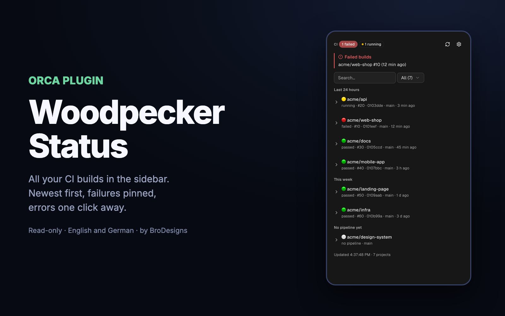
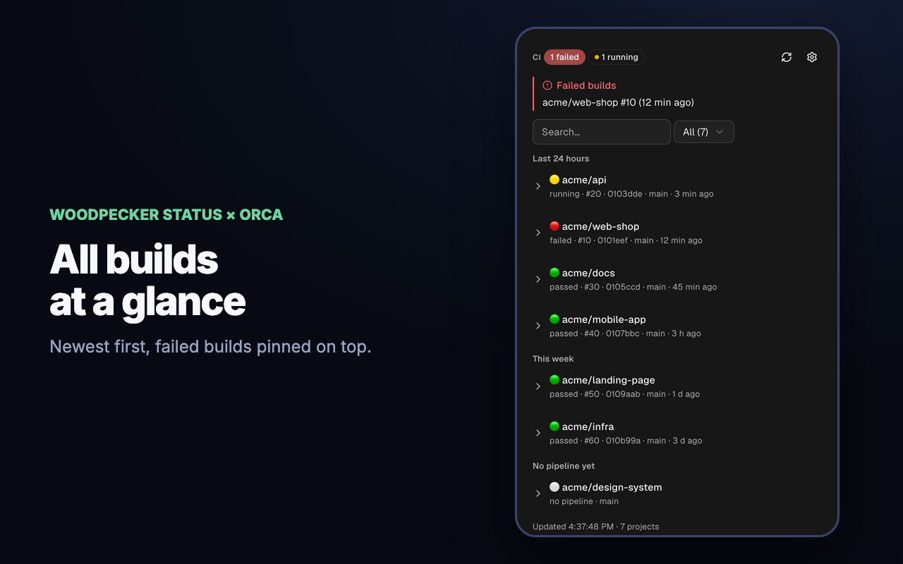
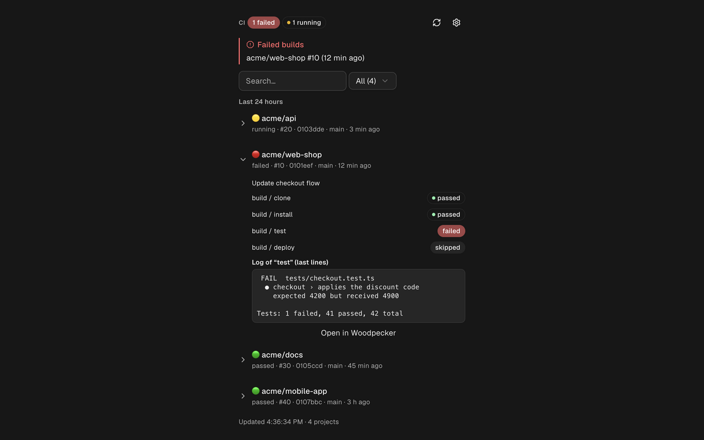
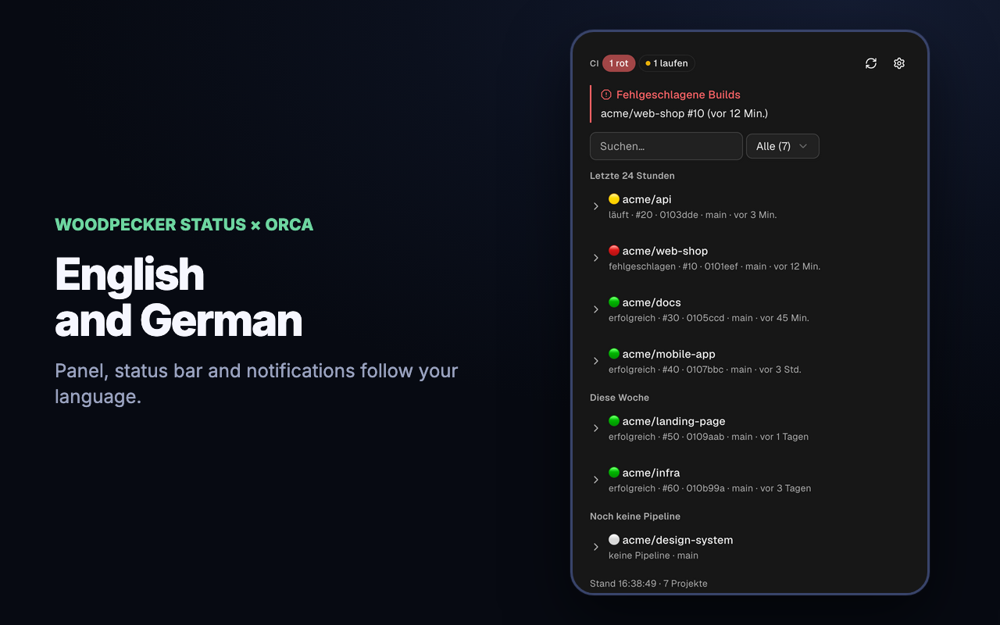
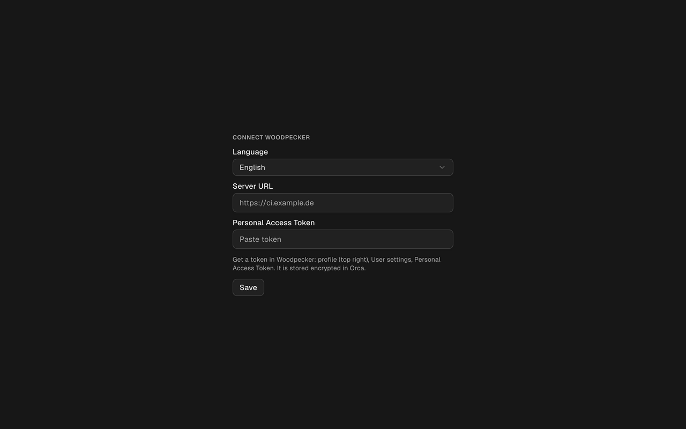
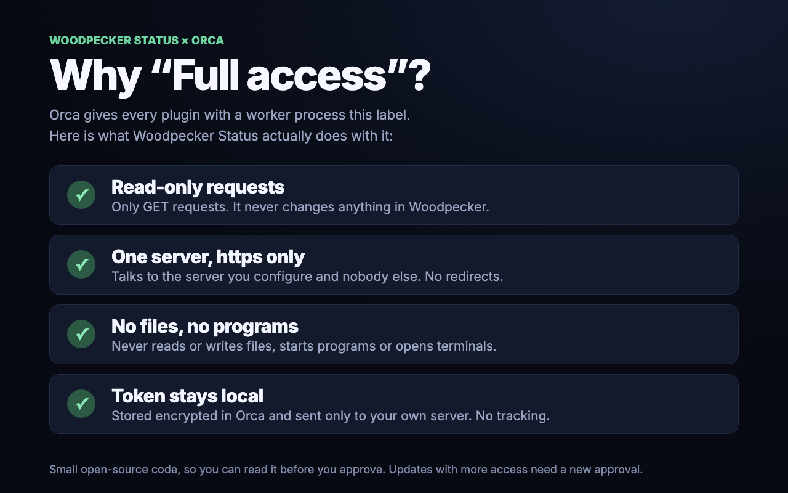

# Woodpecker Status for Orca: see which CI builds failed, without leaving your editor

An [Orca](https://github.com/stablyai/orca) plugin that shows the status of all your [Woodpecker CI](https://woodpecker-ci.org) pipelines in the sidebar. The newest build is on top, failed builds are pinned, and the error log is one click away.



## Why

A broken build is easy to miss when the CI lives in another browser tab. Woodpecker Status puts every project's latest build next to your code and tells you the moment one turns red, and again when it is fixed.

## What you get

- **Know instantly if something broke.** A red banner lists failed builds, and the status bar shows `CI 2 failed`, `CI 1 running` or `CI ok`.
- **See the newest build first.** Every project shows status, build number, commit, branch and age, sorted by the last change.
- **Find the cause in seconds.** Click a project for its steps, errors and the last 30 log lines of up to three failed steps, without color codes.
- **Get told when it turns red, and when it is fixed.** Desktop notification for every new failure and for every recovery (can be switched off).
- **Stays light on your server.** Skips inactive projects, uses one feed request for most projects, backs off after errors and keeps the last known status on a hiccup, so you get no duplicate alerts.
- **Find any project fast.** Search by name, branch, commit or message, and filter by failed, running or passed.
- **English and German.** Switch in the panel settings.

## See it

**All builds at a glance.** Newest first, failed builds pinned on top, with search and status filter.



**Find the cause in seconds.** Open a failed build to see its steps and the log of the failed step.



**English and German.** Panel, status bar and notifications follow your language.



**Set up in a minute.** Language, server URL and access token, nothing else.



## Install

Needs Orca 1.4.248 or newer.

1. In Orca, open **Settings → Plugins** and add the marketplace `https://github.com/stablyai/orca-community-plugins.git` (ref `main`).
2. Search for **Woodpecker Status** and install it.
3. Check the access it asks for and approve it.

## Set up

1. Open the **Woodpecker Status** panel (rocket icon in the right sidebar).
2. Enter your server URL, for example `https://ci.example.com`.
3. Create a token in Woodpecker (profile → User settings → Personal Access Token) and paste it.

The token is stored encrypted in Orca and never shown again. Leave the field empty on later edits to keep it.

## Settings

| Setting | Default | What it does |
|---|---|---|
| Woodpecker URL | empty | Your server, for example `https://ci.example.com` |
| Language | `en` | `en` or `de` for panel, status bar and notifications |
| Notify when fixed | on | Notification when a build turns green after a failure |
| Default branch only | off | Show the latest build of each project's default branch instead of any branch |

Up to 200 projects are shown; the panel tells you if you have more.

## What's new in 1.2

- "CI fixed" notification and the `Notify when fixed` setting
- `Default branch only` setting
- Fewer requests: inactive projects are skipped and the feed is used
- Last known status is kept on temporary errors, polling backs off (30 s, 60 s, 120 s)
- Log excerpts of up to three failed steps, ANSI codes removed
- Detail view refreshes for running pipelines and retries after errors

## Privacy and access

Orca labels every plugin with a worker "Full access". Here is what this one does with it:



- Read-only: only `GET` requests, it never changes anything in Woodpecker.
- Talks to your server only, over `https://` (plain `http://` only for `localhost`). No redirects.
- No files, no programs, no terminals. No tracking, no third-party services.
- The token is only sent to your own server. Responses are limited to 5 MB.

| Access | Why |
|---|---|
| `trusted-worker` | Calls the Woodpecker API (panels have no network access) |
| `settings:own` | Stores server URL, language and options |
| `secrets:own` | Stores the token |
| `notifications:show` | Desktop notification on a failed or fixed pipeline |

The code is about 900 lines in `src/`, so you can read all of it before you approve.

<details>
<summary>Install from source (development)</summary>

```sh
git clone https://github.com/brodesigns/orca-woodpecker-status
cd orca-woodpecker-status
orca plugin dev load .
orca plugin dev load . --approve <fingerprint>
orca plugin test .
```

</details>

## About

Built and maintained by [BroDesigns](https://brodesigns.de), a web agency that runs its own CI on Woodpecker.

## License

MIT
