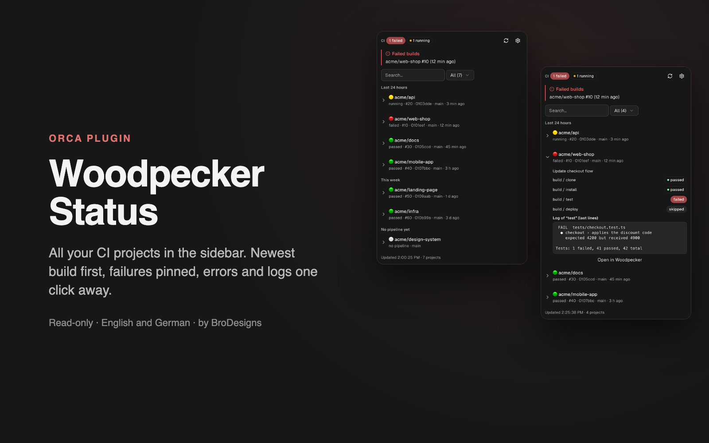
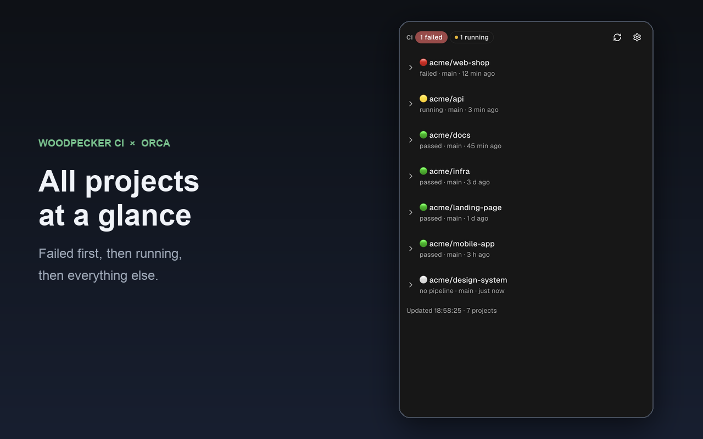
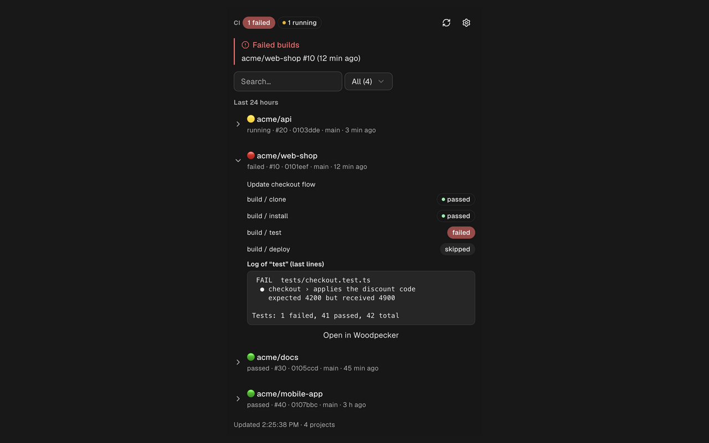
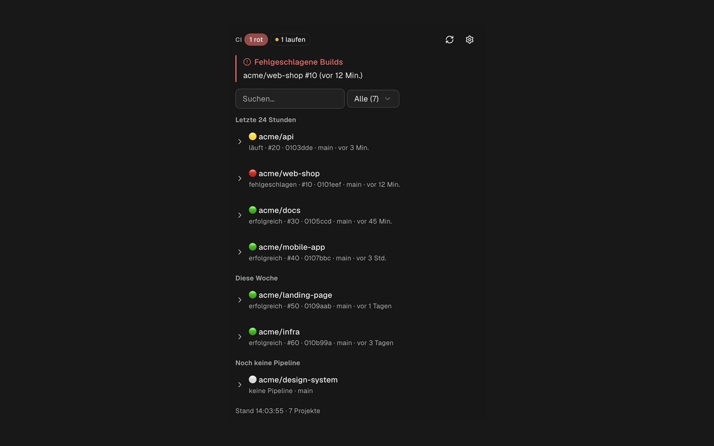
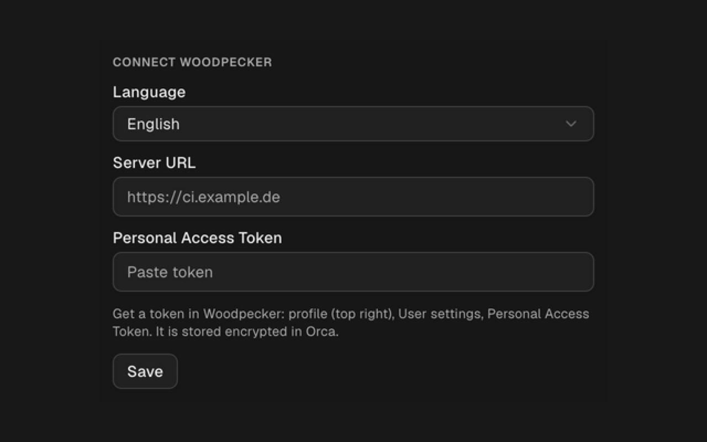
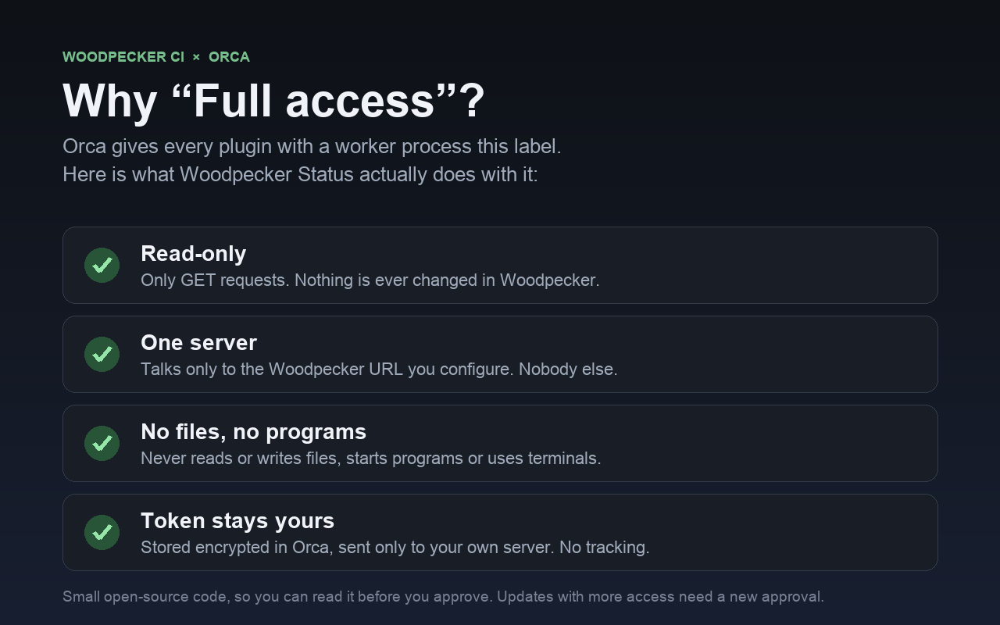

# Woodpecker Status: CI build status plugin for Orca

See the status of all your [Woodpecker CI](https://woodpecker-ci.org) pipelines in [Orca](https://onorca.dev)'s sidebar. The newest build is on top, failed builds are pinned, and the error log is one click away. No tab switching, no browser.



## Why you want it

- **Know instantly if something broke.** A red banner lists failed builds, and the status bar shows `CI 2 failed`, `CI 1 running` or `CI ok`.
- **See the newest build first.** Every project shows status, build number, commit, branch and age, sorted by the last change.
- **Find the cause in seconds.** Click a project for its steps, errors and the last 30 log lines of the failed step.
- **Get told when it turns red.** Desktop notification for every new failure.
- **Find any project fast.** Search by name, branch, commit or message, and filter by failed, running or passed.
- **English and German.** Switch in the panel settings.

## Screenshots





<details>
<summary>German version and setup</summary>





</details>

## Install

Needs Orca 1.4.248 or newer.

1. In Orca, open **Settings → Plugins** and add the marketplace `https://github.com/stablyai/orca-community-plugins.git` (ref `main`).
2. Search for **Woodpecker Status** and install it.
3. Check the access it asks for and approve it.

## Set up

1. Open the **Woodpecker Status** panel (rocket icon in the right sidebar).
2. Enter your server URL, for example `https://ci.example.com`.
3. Create a token in Woodpecker (profile → User settings → Personal Access Token) and paste it.

The token is stored encrypted in Orca and never shown again. Leave the field empty on later edits to keep it.

## Safe by design



Orca shows **Full access** for every plugin that runs a worker, because a worker is a Node.js process. This one stays small and strict:

- Read-only: only `GET` requests, it never changes anything in Woodpecker.
- Talks to your server only, over `https://` (plain `http://` only for `localhost`). No redirects.
- No files, no programs, no terminals. No tracking, no third-party services.
- The token is only sent to your own server. Responses are limited to 5 MB.

| Access | Why |
|---|---|
| `trusted-worker` | Calls the Woodpecker API (panels have no network access) |
| `settings:own` | Stores server URL and language |
| `secrets:own` | Stores the token |
| `notifications:show` | Desktop notification on a failed pipeline |

The code is about 900 lines in `src/`, so you can read all of it before you approve.

<details>
<summary>Install from source (development)</summary>

```sh
git clone https://github.com/brodesigns/orca-woodpecker-status
cd orca-woodpecker-status
orca plugin dev load .
orca plugin dev load . --approve <fingerprint>
orca plugin test .
```

</details>

## About

Built and maintained by [BroDesigns](https://brodesigns.de), a web agency that runs its own CI on Woodpecker.

## License

MIT
